# Original homework figures

Historical figures supplied with HW2. They are not newly reproduced simulations. See [the homework guide](../README.md) and original PDFs in this folder.

## 1

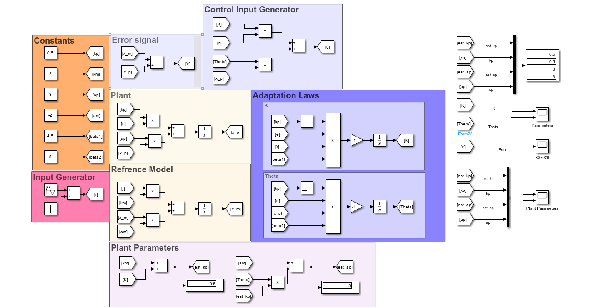

## 10

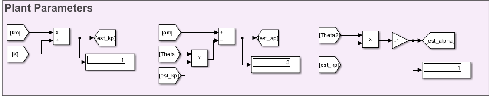

## 11

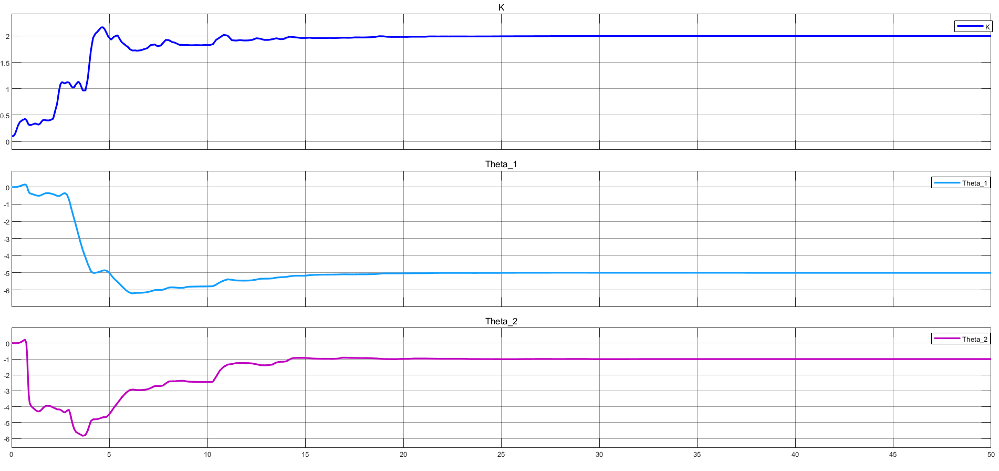

## 12

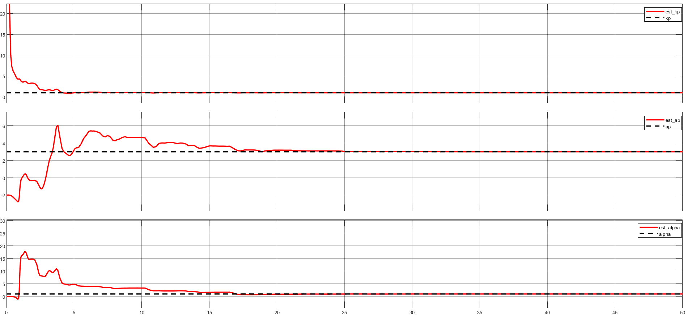

## 13

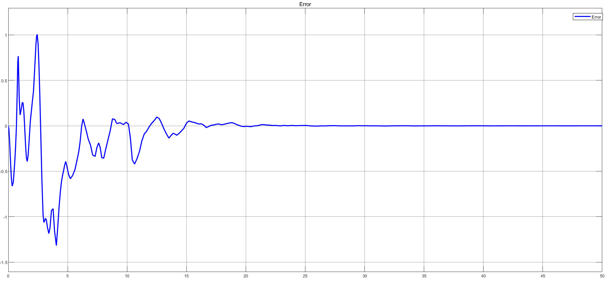

## 2

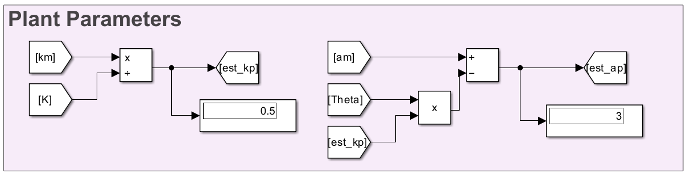

## 3

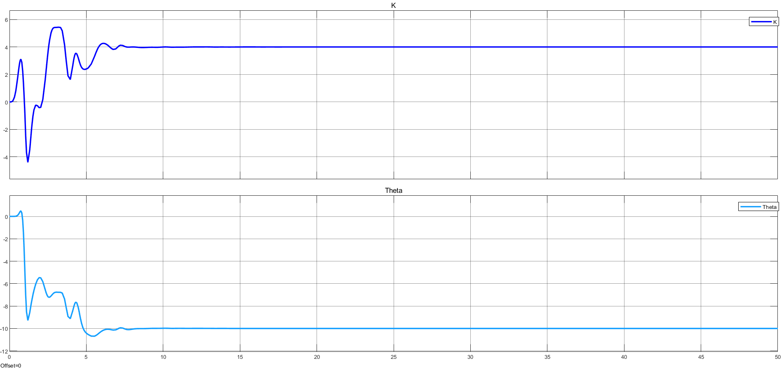

## 4

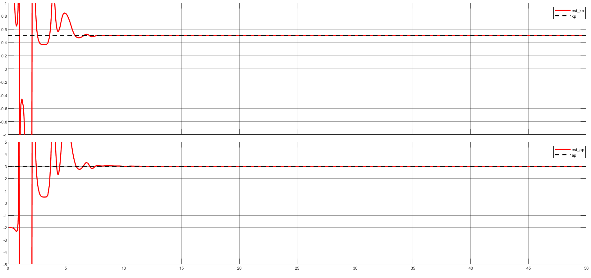

## 5

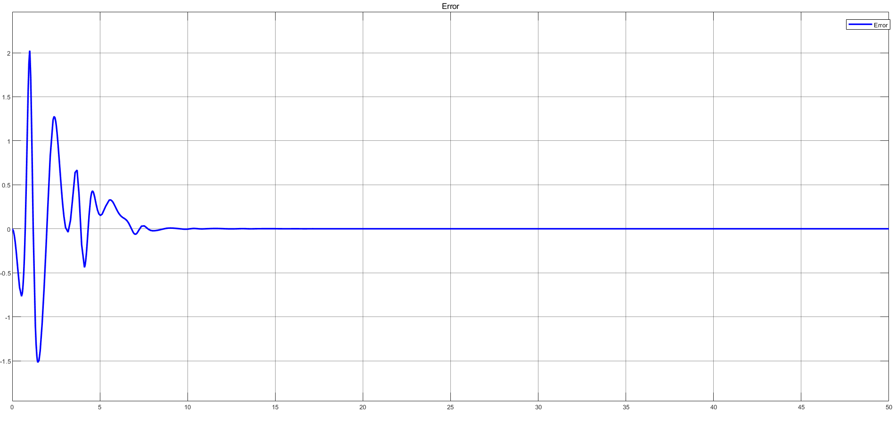

## 6

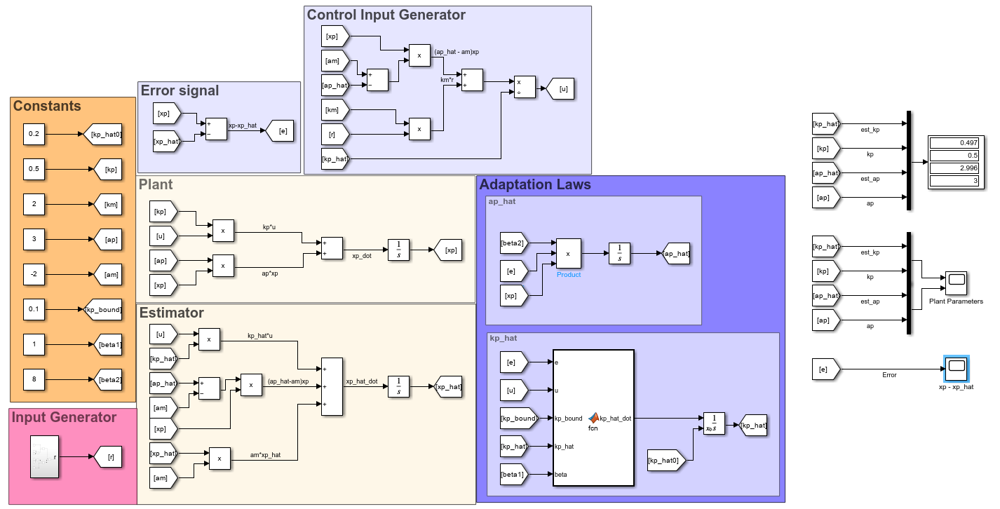

## 7

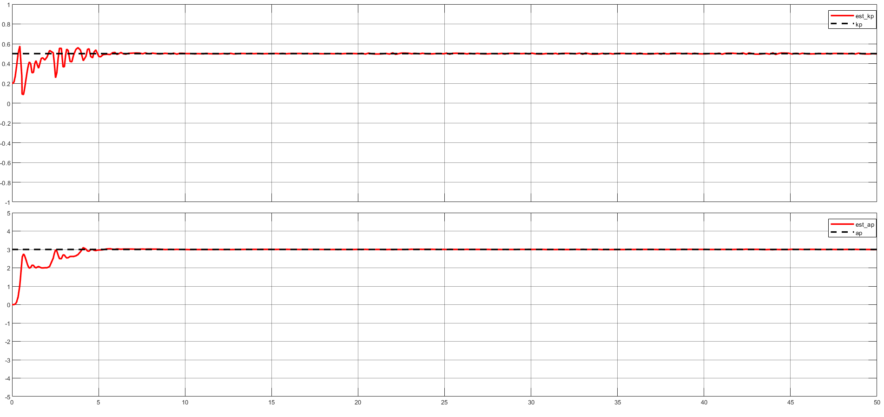

## 8

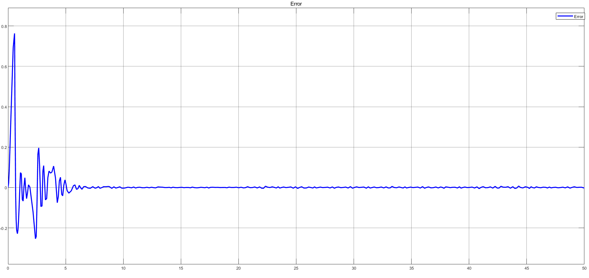

## 9

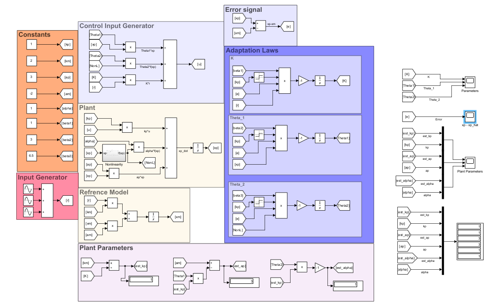
