# Original homework figures

Historical figures supplied with HW3. They are not newly reproduced simulations. See [the homework guide](../README.md) and original PDFs in this folder.

## Error_final

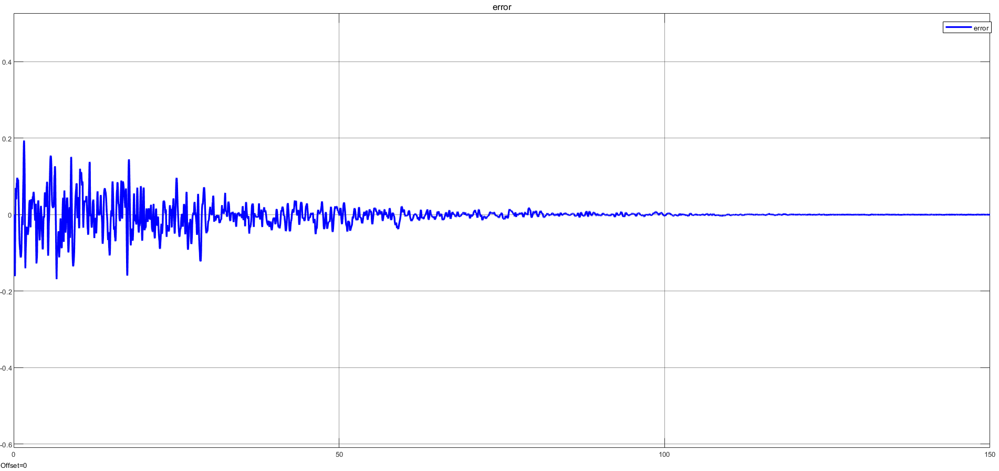

## Error_STEP

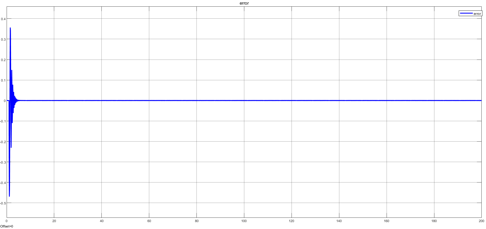

## Error_unstable

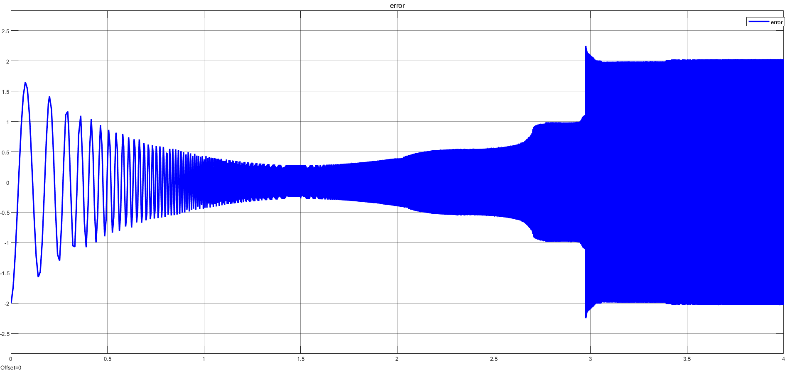

## Main

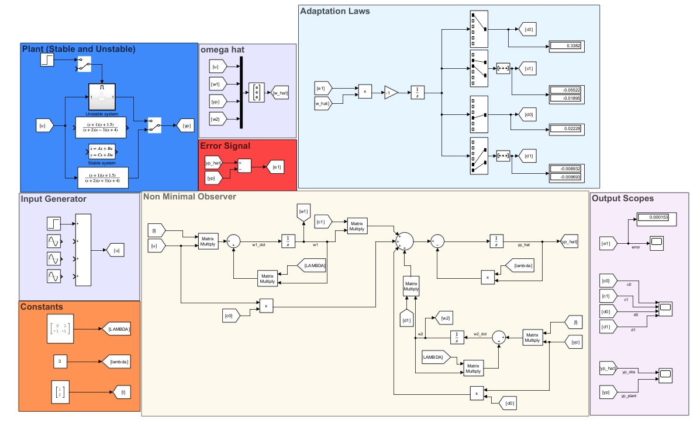

## Out_final

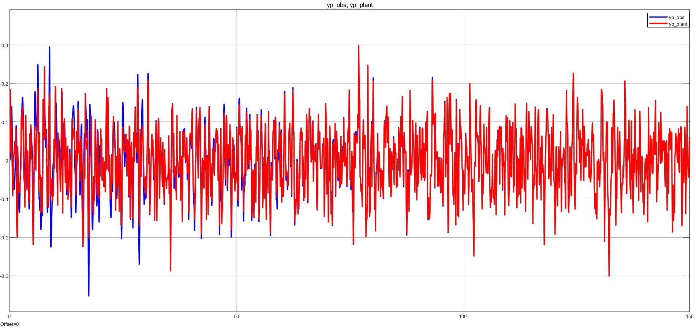

## Out_STEP

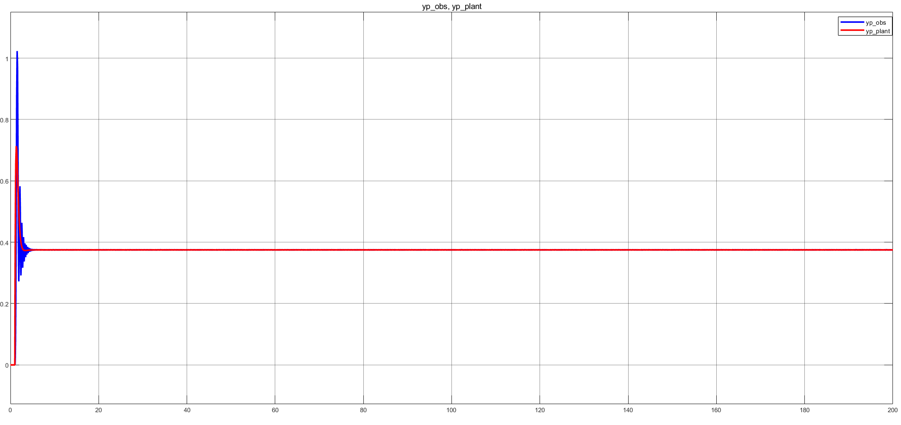

## Out_unstable

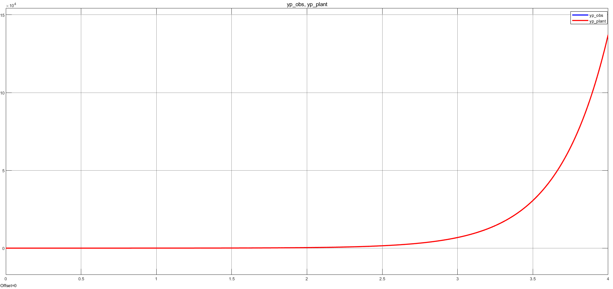

## Parameters_final

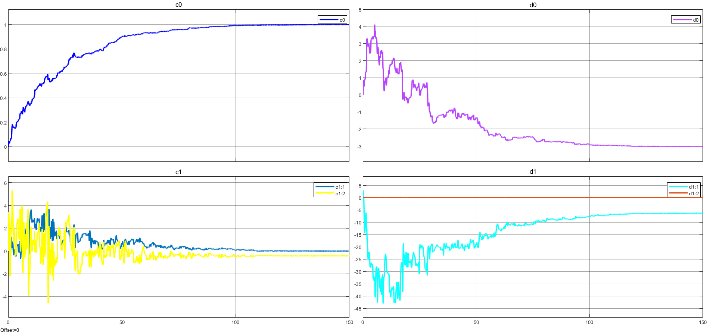

## Parameters_STEP

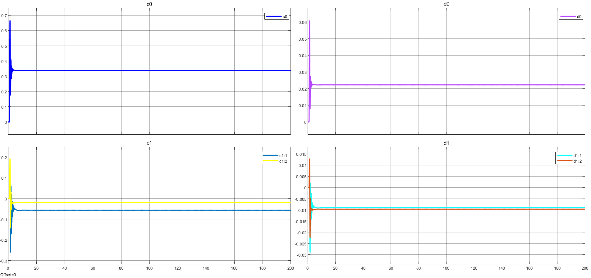

## Parameters_unstable

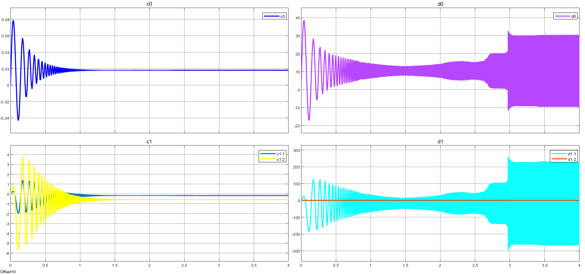

## Plant

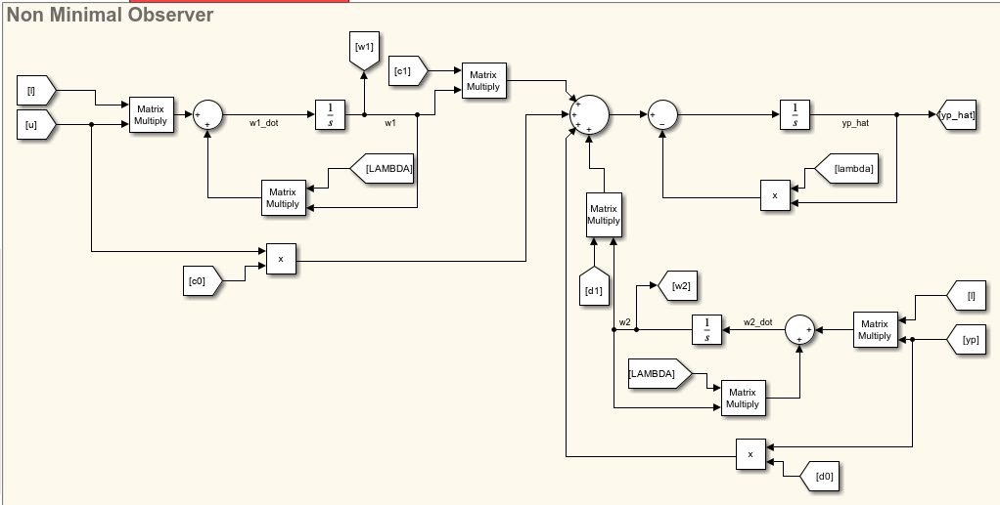
