# Original homework figures

Historical figures supplied with HW4. They are not newly reproduced simulations. See [the homework guide](../README.md) and original PDFs in this folder.

## 3Sine

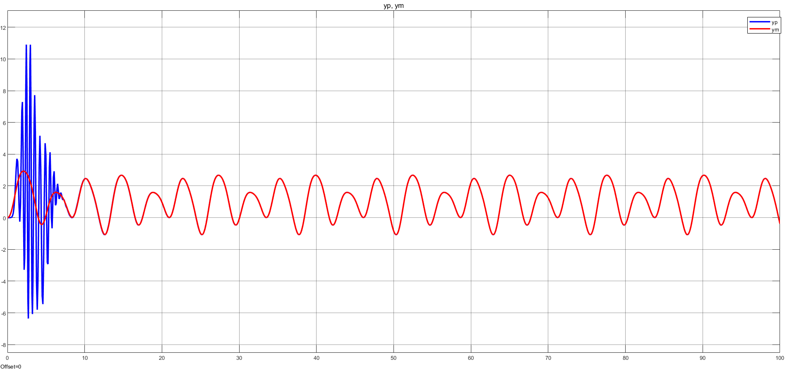

## Error_3Sine

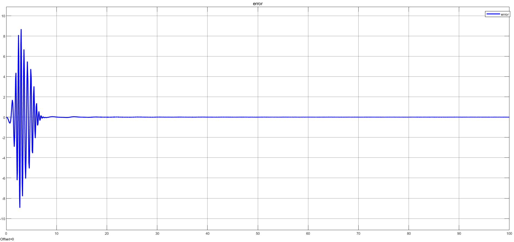

## error_final

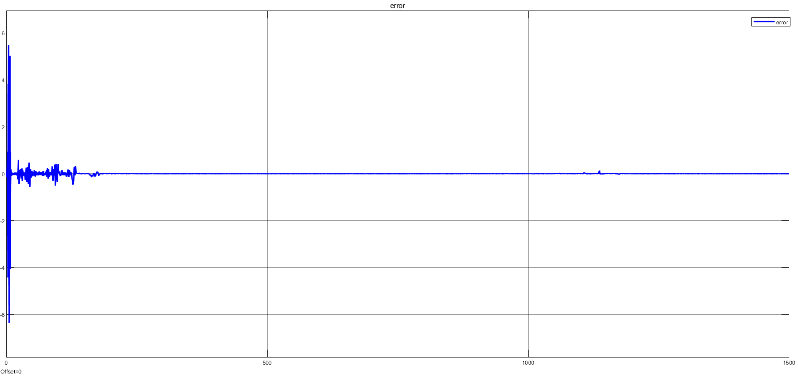

## Error_step_sine

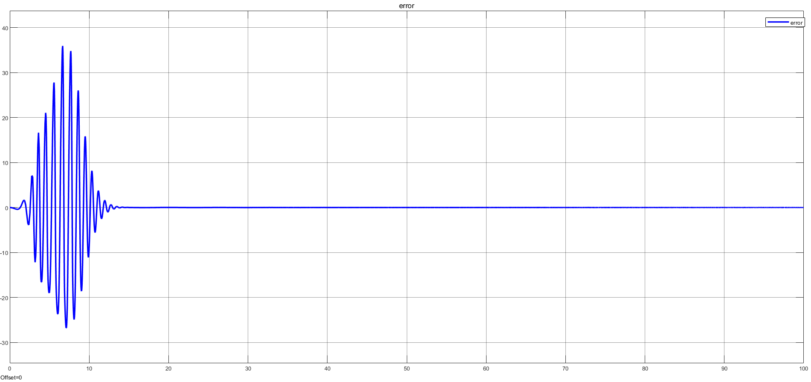

## final

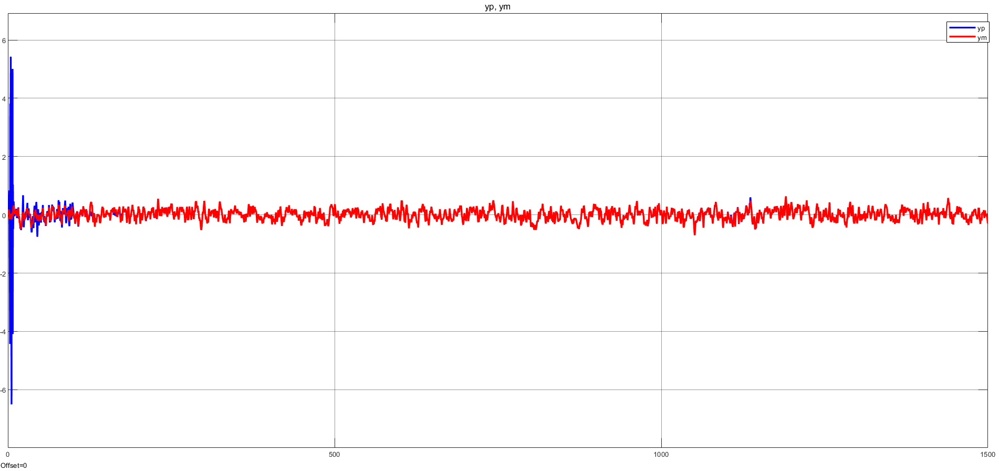

## Parameters_3sine

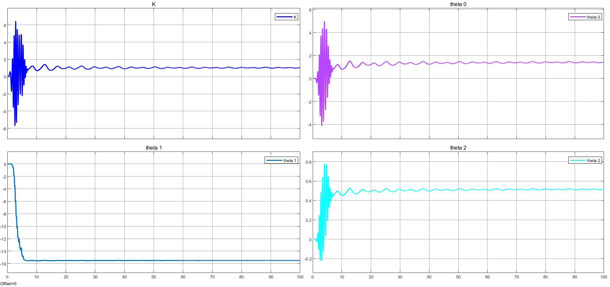

## Parameters_step_sine

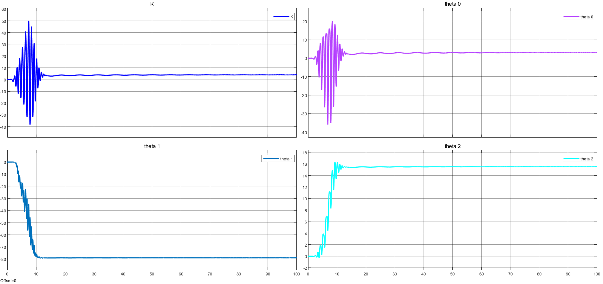

## Parm_final

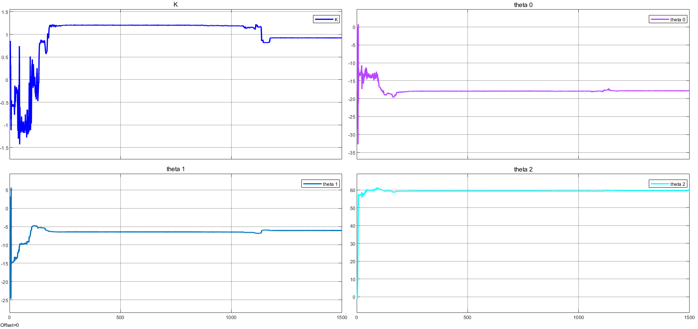

## Plant

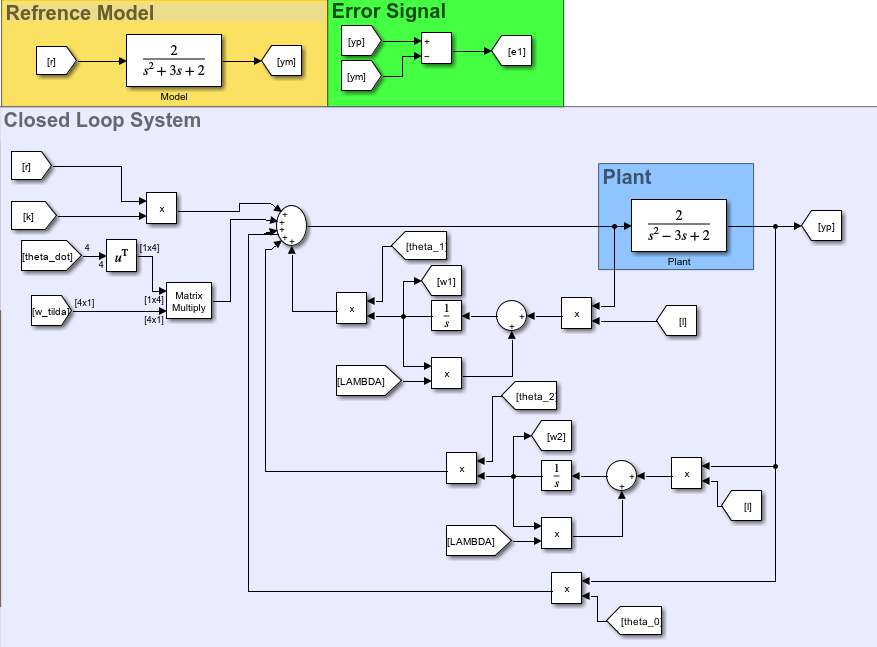

## Sim

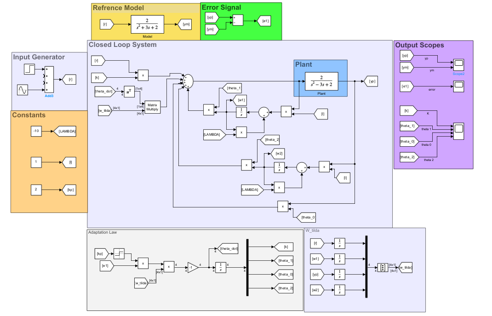

## Step_sine

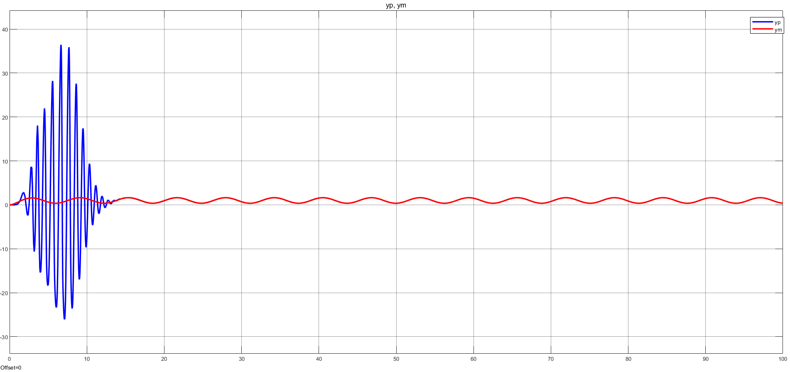
